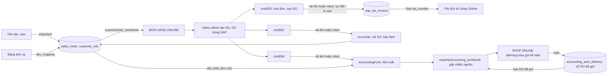

# Kiến trúc hệ thống

Dành cho lập trình viên và người quản trị tiếp nhận hệ thống. Luồng nghiệp vụ: [README](../README.md). Lý do của các quyết định: [plan](../plans/261111-0755-shopee-excel-to-sap-order-flow/plan.md) và các báo cáo brainstorm trong `plans/reports/`.

## Tổng quan

Một gói Python `shoponline`, một database PostgreSQL, một máy Windows. Hai tiến trình dài hạn chạy bằng Task Scheduler:

| Tiến trình | Lệnh | Chạy trong | Việc |
|---|---|---|---|
| `web` | `shoponline web` | tài khoản hệ thống | FastAPI + Jinja2, render phía máy chủ; nhập file, sinh file, xếp việc cho robot |
| `robot` | `shoponline robot` | phiên đăng nhập của tài khoản robot (cần màn hình cho SAP GUI) | Nhận việc từ hàng đợi, đọc `ZRSD001`, `ZRSD004` trên Production bằng SAP GUI Scripting |

Ba tác vụ định kỳ: `shoponline-backup` (sao lưu mã hóa), `shoponline-retention` (xóa file hết dùng, liệt kê hoặc xóa dữ liệu khách quá hạn), và runner deploy `shoponline-deploy-runner`. Đăng ký bằng [register-tasks.ps1](../scripts/windows/register-tasks.ps1) và [install-deploy-runner.ps1](../scripts/windows/install-deploy-runner.ps1).

Hệ thống không ghi gì vào SAP. Không có API sàn, không Docker, không LLM trong đường nghiệp vụ.

## Luồng dữ liệu

Tải file lên và robot đi qua cùng một hàm, [report_ingest.py](../src/shoponline/reconcile/report_ingest.py), nên kết quả giống hệt nhau. File robot xuất ra được lưu như một file tải lên (`import_batch`).

## Mô-đun

| Thư mục | Trách nhiệm |
|---|---|
| `config.py`, `cli.py` | Đọc biến môi trường; các lệnh `shoponline …` |
| `db/` | Model SQLAlchemy, phiên; schema đổi qua Alembic trong `migrations/versions/` |
| `domain/` | Trạng thái đơn và chuyển trạng thái, ánh xạ SKU, ngày goods issue, giá trị SO dự kiến |
| `importers/` | Đọc file Shopee, TikTok, Lazada, `zrsd001`, `zrsd003`, `zrsd004`, bảng ánh xạ; nhận cột theo tên, thiếu cột bắt buộc thì từ chối cả file |
| `exports/` | File `ĐƠN HÀNG ONLINE`, dòng cho file lịch sử Shop Online và file gửi kế toán (một file `zrsd004`: giữ nguyên, chèn ba cột; nhiều file: gộp, lọc, tính lại dòng tổng) |
| `accounting/` | Sổ DO đã gửi kế toán và mốc ngày (`ledger.py`); đợt xuất: cặp sàn × ngày cần đọc, đối chiếu, bản nháp, chốt, hủy (`runs.py`) |
| `clock.py` | "Hôm nay" theo múi giờ `Asia/Saigon`, dùng chung cho cả ứng dụng |
| `reconcile/` | Nối SO với đơn theo `PO No`, báo lệch, đánh dấu đã có DO |
| `sapjobs/` | Hàng đợi `sap_job` (nhận việc bằng `FOR UPDATE SKIP LOCKED`), công tắc dừng robot, xếp việc đọc báo cáo |
| `saprobot/` | Robot: lớp chặn T-code (`guard.py`), phiên, thanh trạng thái, popup, ảnh lỗi, cửa sổ Windows (`desktop.py`), vòng lặp (`worker.py`), thao tác đọc báo cáo (`transactions/`) |
| `maintenance/` | Quy tắc giữ file, xóa file hết dùng và dữ liệu khách quá thời hạn lưu (`retention.py`) |
| `web/` | Route, template, xác thực, lưu file tải lên |
| `config/` (gốc repo) | ID phần tử màn hình SAP và danh sách popup đã biết, lấy từ bản ghi recorder |

## Trạng thái đơn

`NEW` → `READY` (đủ ánh xạ) → `SO_LINKED` (có trong `zrsd001`) → `DELIVERED` (có trong `zrsd004`). Nhánh phụ: `MAPPING_ERROR`, `NEED_REVIEW`, `CANCELLED`. Mọi thay đổi đi qua `domain/states.transition` và được ghi vào `event_log`. Bảng chuyển trạng thái: [states.py](../src/shoponline/domain/states.py).

## Đợt gửi kế toán

Bảng `accounting_run` (một đợt: `OPEN`, `FINALIZED`, `CANCELLED`, `REVOKED`; tối đa một đợt `OPEN`), `accounting_run_read` (cặp sàn × ngày goods issue và việc robot tương ứng), `accounting_run_source` (file `zrsd004` tải tay gắn vào đợt), `accounting_sent_delivery` (sổ theo số Delivery) và `accounting_baseline` (mốc ngày). Chốt là một giao dịch: lưu file, ghi DO vào sổ, đóng đợt, ghi sự kiện. Chốt chỉ nhận đúng bản đã xem (dấu vân tay của nguồn, DO và danh sách thiếu). Các bước vận hành: [daily-operations.md](daily-operations.md).

## File lịch sử Shop Online

Trang `/sales-history` dựng dòng nối tiếp cho file lịch sử của kế toán ([sales_history_workbook.py](../src/shoponline/exports/sales_history_workbook.py)): mọi đơn `DELIVERED` chưa có trong `sales_history_exported`, đặt tới hết ngày chọn, mỗi dòng sản phẩm một dòng 19 cột (17 cột của file kế toán, rồi `Mã đơn` và `Tax Invoice Doc.`). Số hóa đơn lấy từ `sap_tax_invoice` (khóa `delivery`, nạp từ `zrsd003` bởi `ingest_zrsd003`) theo `sales_order.do_number`; đơn chưa có hóa đơn bị chặn, và trang xếp việc robot `read_zrsd003` cho khoảng ngày cần đọc. Tỉnh/thành tách từ `customer_info.address`, itemName, kích cỡ, variation lấy từ `report_item_name` theo mã vật tư (sửa ở `/report-names`, gợi ý từ `sku_mapping`; [report_names.py](../src/shoponline/domain/report_names.py)). Đơn thiếu một giá trị thì bị chặn, không đoán.

Bảng `sales_history_file_order` ghi các đơn có trong từng file đã tải (`generated_file` kind `sales_history`); `sales_history_exported` (khóa chính `sales_order_id`) ghi đơn đã được xác nhận là đã dán, kèm file đã xác nhận. Xác nhận chép danh sách đơn của file sang sổ, bỏ qua đơn đã có; gỡ xác nhận xóa đúng các dòng của file đó.

## Robot

Vòng lặp của `worker.py`: kiểm tra công tắc → nhận một việc → kiểm tra phiên SAP đúng hệ thống, client, user của việc → bọc phiên bằng lớp chặn → chạy thao tác → ghi kết quả. Một robot duy nhất nhờ khóa advisory của PostgreSQL. Lỗi liên tiếp quá ngưỡng, sai hệ thống, hoặc lớp chặn bắt được thao tác lạ thì robot tự tạm dừng; chỉ `admin` bật lại.

Lớp chặn T-code, danh sách được phép và cách xử lý: [robot-runbook.md](robot-runbook.md#lớp-chặn-t-code).

## Dữ liệu trên đĩa

Dưới `SHOPONLINE_DATA_DIR`:

| Thư mục | Nội dung | Thời hạn |
|---|---|---|
| `uploads/` | File tải lên và file robot xuất, đặt tên theo SHA-256 | Tới khi hết dùng: chỉ giữ `zrsd004` của đợt đang mở và `zrsd004` upload tay chờ gắn |
| `exports/` | File hệ thống sinh ra | File kế toán của đợt: giữ. File Shop Online: tới khi xác nhận hết đơn. File đơn hàng: xóa sau khi tải |
| `robot-work/job-<n>/` | File báo cáo robot vừa xuất từ SAP | Xóa khi việc `DONE`; việc lỗi giữ tới hết hạn ảnh màn hình |
| `robot-evidence/` | Ảnh màn hình khi việc lỗi | `SHOPONLINE_ROBOT_EVIDENCE_KEEP_DAYS` (30) |
| `logs/` | `web.log`, `robot.log`, `retention.log` | Mỗi file xoay vòng 10 × 5 MB |

Quy tắc giữ file chi tiết: [security-and-data-retention.md](security-and-data-retention.md#file).
| `last-backup.txt` | Thời điểm sao lưu gần nhất; web cảnh báo sau 36 giờ | — |

## Triển khai

Push lên `main` → GitHub Actions chạy test → runner trên máy chạy thật gọi [update-production.ps1](../scripts/windows/update-production.ps1): sao lưu, cập nhật mã, `migrate`, khởi động lại web. Chi tiết: [deployment-guide.md](deployment-guide.md).

Hiện tại (từ 2026-11-12) máy phát triển kiêm máy chạy thật, bản chạy thật ở `C:\shoponline`. Chuyển sang máy riêng là một bước của phase 9.

## Thêm một sàn mới

1. Viết bộ đọc file "chờ giao hàng" của sàn trong `importers/`, theo mẫu [shopee_orders.py](../src/shoponline/importers/shopee_orders.py), kèm file mẫu tự dựng trong `tests/fixtures`.
2. Thêm một dòng `platform_setting` (mã sàn, tên hiển thị, khách hàng SAP) bằng một migration.
3. Nhập bảng ánh xạ của sàn ở trang **Ánh xạ SAP**.

Robot không cần sửa: bộ lọc báo cáo lấy khách hàng SAP từ `platform_setting`.
