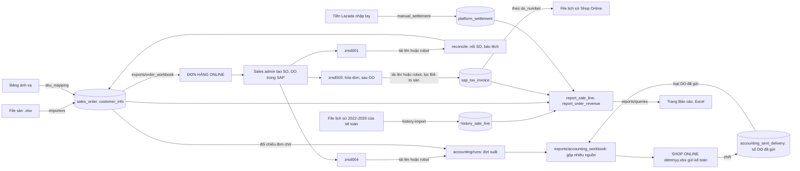

# Kiến trúc hệ thống

Dành cho lập trình viên và người quản trị tiếp nhận hệ thống. Luồng nghiệp vụ: [README](../README.md). Lý do của các quyết định: [plan](../plans/261111-0755-shopee-excel-to-sap-order-flow/plan.md) và các báo cáo brainstorm trong `plans/reports/`.

## Tổng quan

Một gói Python `shoponline`, một database PostgreSQL, một máy Windows. Hai tiến trình dài hạn chạy bằng Task Scheduler:

| Tiến trình | Lệnh | Chạy trong | Việc |
|---|---|---|---|
| `web` | `shoponline web` | tài khoản hệ thống | FastAPI + Jinja2, render phía máy chủ; nhập file, sinh file, xếp việc cho robot |
| `robot` | `shoponline robot` | phiên đăng nhập của tài khoản robot (cần màn hình cho SAP GUI) | Nhận việc từ hàng đợi, đọc `ZRSD001`, `ZRSD004` trên Production bằng SAP GUI Scripting |

Các tác vụ: `shoponline-backup` (mỗi 15 phút, làm việc đang chờ rồi bản tới lịch), `shoponline-restore` (không có lịch; web gọi nó khi admin bấm phục hồi), `shoponline-retention` (xóa file hết dùng; dữ liệu khách được giữ vĩnh viễn), và runner deploy `shoponline-deploy-runner`. Đăng ký bằng [register-tasks.ps1](../scripts/windows/register-tasks.ps1) và [install-deploy-runner.ps1](../scripts/windows/install-deploy-runner.ps1).

Hệ thống không ghi gì vào SAP. Không có API sàn, không Docker, không LLM trong đường nghiệp vụ.

## Luồng dữ liệu

Tải file lên và robot đi qua cùng một hàm, [report_ingest.py](../src/shoponline/reconcile/report_ingest.py), nên kết quả giống hệt nhau. File robot xuất ra được lưu như một file tải lên (`import_batch`).

## Mô-đun

| Thư mục | Trách nhiệm |
|---|---|
| `config.py`, `cli.py` | Đọc biến môi trường; các lệnh `shoponline …` |
| `db/` | Model SQLAlchemy, phiên; schema đổi qua Alembic trong `migrations/versions/` |
| `domain/` | Trạng thái đơn và chuyển trạng thái, ánh xạ SKU, ngày goods issue, giá trị SO dự kiến |
| `importers/` | Đọc file Shopee, TikTok, Lazada, PDF phiếu vận đơn Shopee/TikTok ([shipping_label_pdf.py](../src/shoponline/importers/shipping_label_pdf.py); [customer_labels.py](../src/shoponline/importers/customer_labels.py) ghi kết quả vào `customer_info` theo cột nguồn địa chỉ `address_source`), file quyết toán Shopee/TikTok, `zrsd001`, `zrsd003`, `zrsd004`, bảng ánh xạ; nhận cột theo tên, thiếu cột bắt buộc thì từ chối cả file |
| `exports/` | File `ĐƠN HÀNG ONLINE`, dòng cho file lịch sử Shop Online và file gửi kế toán (một file `zrsd004`: giữ nguyên, chèn ba cột; nhiều file: gộp, lọc, tính lại dòng tổng) |
| `accounting/` | Sổ DO đã gửi kế toán và mốc ngày (`ledger.py`); đợt xuất: cặp sàn × ngày cần đọc, đối chiếu, bản nháp, chốt, hủy (`runs.py`) |
| `clock.py` | "Hôm nay" theo múi giờ `Asia/Saigon`, dùng chung cho cả ứng dụng |
| `reconcile/` | Nối SO với đơn theo `PO No`, báo lệch, đánh dấu đã có DO |
| `sapjobs/` | Hàng đợi `sap_job` (nhận việc bằng `FOR UPDATE SKIP LOCKED`), công tắc dừng robot, xếp việc đọc báo cáo |
| `saprobot/` | Robot: lớp chặn T-code (`guard.py`), phiên, thanh trạng thái, popup, ảnh lỗi, cửa sổ Windows (`desktop.py`), vòng lặp (`worker.py`), thao tác đọc báo cáo (`transactions/`) |
| `reports/` | Báo cáo cho quản lý: mốc `REPORTING_CUTOVER`, nạp file lịch sử (`history_import.py`), truy vấn tổng hợp trên hai view (`queries.py`) |
| `maintenance/` | Quy tắc giữ file và xóa file hết dùng (`retention.py`) |
| `web/` | Route, template, xác thực, lưu file tải lên |
| `config/` (gốc repo) | ID phần tử màn hình SAP và danh sách popup đã biết, lấy từ bản ghi recorder |

## Trạng thái đơn

`NEW` → `READY` (đủ ánh xạ) → `SO_LINKED` (có trong `zrsd001`) → `DELIVERED` (có trong `zrsd004`). Nhánh phụ: `MAPPING_ERROR`, `NEED_REVIEW`, `CANCELLED`. Mọi thay đổi đi qua `domain/states.transition` và được ghi vào `event_log`. Bảng chuyển trạng thái: [states.py](../src/shoponline/domain/states.py).

## Đợt gửi kế toán

Bảng `accounting_run` (một đợt: `OPEN`, `FINALIZED`, `CANCELLED`, `REVOKED`; tối đa một đợt `OPEN`), `accounting_run_read` (cặp sàn × ngày goods issue và việc robot tương ứng), `accounting_run_source` (file `zrsd004` tải tay gắn vào đợt), `accounting_sent_delivery` (sổ theo số Delivery) và `accounting_baseline` (mốc ngày). Chốt là một giao dịch: lưu file, ghi DO vào sổ, đóng đợt, ghi sự kiện. Chốt chỉ nhận đúng bản đã xem (dấu vân tay của nguồn, DO và danh sách thiếu). Các bước vận hành: [daily-operations.md](daily-operations.md).

## File lịch sử Shop Online

Trang `/sales-history` dựng dòng nối tiếp cho file lịch sử của kế toán ([sales_history_workbook.py](../src/shoponline/exports/sales_history_workbook.py)): mọi đơn `DELIVERED` chưa có trong `sales_history_exported`, đặt tới hết ngày chọn, mỗi dòng sản phẩm một dòng 20 cột (17 cột của file kế toán, rồi `Mã đơn`, `Tax Invoice Doc.` và `Tiền Vô`). Số hóa đơn lấy từ `sap_tax_invoice` (khóa `delivery`, nạp từ `zrsd003` bởi `ingest_zrsd003`) theo `sales_order.do_number`; đơn chưa có hóa đơn bị chặn, và trang xếp việc robot `read_zrsd003` cho khoảng ngày cần đọc. Tiền vô lấy từ `platform_settlement` (một dòng mỗi giao dịch, khóa `(platform, line_key)`; nạp từ file quyết toán Shopee/TikTok bởi `read_settlement_file` và `ingest_settlement`, sàn nhận theo nội dung file): tổng theo `(platform, platform_order_id)`, ghi ở dòng đầu của đơn; đơn Shopee/TikTok chưa có dòng nào nằm ở hộp "Đơn chờ tiền vô", Lazada để trống. Tỉnh/thành tách từ `customer_info.address`, itemName, kích cỡ, variation lấy từ `report_item_name` theo mã vật tư (sửa ở `/report-names`, gợi ý từ `sku_mapping`; [report_names.py](../src/shoponline/domain/report_names.py)). Đơn thiếu một giá trị thì bị chặn, không đoán. `/sales-history/draft` gọi `collect_rows(draft=True)`: chấp nhận thêm đơn chỉ có lý do `tax_invoice` hoặc `settlement`, ghi thêm cột 21 `Trạng thái`, trả file từ bộ nhớ và không ghi `generated_file` hay `sales_history_file_order`. `/sales-history/all` gọi `collect_all_rows`: mọi đơn có `ordered_at` trong khoảng ngày, mọi trạng thái, không chặn đơn nào, trả file từ bộ nhớ và không ghi `generated_file`, `sales_history_file_order` hay `sales_history_exported`.

Bảng `sales_history_file_order` ghi các đơn có trong từng file đã tải (`generated_file` kind `sales_history`); `sales_history_exported` (khóa chính `sales_order_id`) ghi đơn đã được xác nhận là đã dán, kèm file đã xác nhận. Xác nhận chép danh sách đơn của file sang sổ, bỏ qua đơn đã có; gỡ xác nhận xóa đúng các dòng của file đó.

## Danh mục shop

Bảng `shop` (mã, sàn, `division`, đang bán, thứ tự). Mỗi đơn mang `sales_order.shop_code`, chọn lúc tải file ở trang **Tải file sàn** (xem [shops.py](../src/shoponline/domain/shops.py)); mỗi lần tải file ghi `import_batch.shop_code`. `division` là chữ ghi vào cột Division của file Shop Online. Shop có đơn thì không xóa được, chỉ tắt. Mỗi sàn luôn còn ít nhất một shop đang bán. Admin sửa ở trang **Shop**.

## Tiền về Lazada nhập tay

File Lazada không có mã đơn, nên admin nhập tiền từng đơn ở trang **Tiền về Lazada** ([manual_settlement.py](../src/shoponline/accounting/manual_settlement.py)). Số nhập nằm trong `platform_settlement` với `source = 'manual'` và đi vào cột `Tiền Vô` của file Shop Online và đường "tiền thực nhận" của báo cáo. Đơn Lazada chưa có số vẫn không bị chặn (chỉ Shopee và TikTok bị chặn khi thiếu tiền).

## Lịch sử bán hàng 2022–2026

`shoponline history-import <file> [--apply]` nạp file `Shop Online 2022-2026` của kế toán vào `history_sale_line` ([history_file.py](../src/shoponline/importers/history_file.py), [history_import.py](../src/shoponline/reports/history_import.py)). Quy tắc:

- **Kỳ** lấy theo cột `month` và `year`. `createTime` có nhiều dạng (và có dòng đảo ngày với tháng), nên chỉ cho `ordered_on` khi một cách đọc khớp tháng của kỳ.
- **Mốc** `REPORTING_CUTOVER = 2026-11-11 00:00` ([reports/__init__.py](../src/shoponline/reports/__init__.py)): lấy kỳ đến 10/2026 và các dòng kỳ 11/2026 có ngày đặt trước mốc; dòng khác bị loại kèm lý do. Từ mốc trở đi số liệu lấy từ đơn của hệ thống, nên không đơn nào bị tính hai lần.
- **Chống trùng:** `line_key` là SHA-256 của các trường chuẩn hóa cộng thứ tự lặp trong file. Nạp lại cùng file hoặc file dài hơn chỉ thêm dòng mới.
- **Shop** theo Division (không phân biệt hoa thường và khoảng trắng) so với bảng `shop`; Division lạ thì dòng bị loại.
- **Tỉnh:** `province_alias` quy tên tỉnh cũ (63) và quận/huyện phổ biến ([districts.py](../src/shoponline/domain/districts.py)) về 34 tỉnh sau sáp nhập 2025. Tên còn lại admin khai ở trang **Quy đổi tỉnh**. Tên huyện trùng ở nhiều tỉnh (Châu Thành, Chợ Mới…) cố ý không tự quy đổi.
- `--apply` ghi trong một giao dịch, giữ bản file trong `exports/history/` (retention giữ lại) và từ chối khi không có bản sao lưu `db` thành công trong 2 giờ (`--skip-backup-check` chỉ cho máy phát triển; việc dùng cờ được ghi trong `event_log`).

## Báo cáo

Trang `/reports` và bốn trang con (sàn và shop, sản phẩm, tỉnh, trả hàng); viewer và admin đều xem, mọi trang tải được Excel bằng `?format=xlsx` ([reports.py](../src/shoponline/web/routes/reports.py), [report_workbook.py](../src/shoponline/exports/report_workbook.py)). Nguồn là hai view ở migration `0016`:

- `report_sale_line`: một dòng mỗi dòng hàng, hợp của lịch sử và đơn hệ thống (từ mốc, không tính đơn hủy). Dùng cho giá trị trên sàn, sản phẩm, tỉnh.
- `report_order_revenue`: một dòng mỗi đơn hệ thống, với ba con số: giá trị trên sàn = (giá − trợ giá) × số lượng; doanh thu hóa đơn = `net_value_vnd + tax_vnd`; tiền thực nhận = tổng `platform_settlement.amount`; kèm giá trị trả của phiếu `ISSUED`. Lịch sử chỉ có đường đầu.

Hai view nằm trong schema `public` (không phải schema riêng) vì khôi phục chạy `DROP SCHEMA public CASCADE` và `pg_dump` mang view theo schema `public`. Đổi view đi qua migration mới. Mốc trong SQL được test so với `REPORTING_CUTOVER`. Phí sàn và chênh giá chỉ cộng trên đơn đủ cả hai số; số đơn còn thiếu hóa đơn hoặc tiền hiện ngay trong bảng.

## Trả hàng sau hóa đơn

Đơn `DELIVERED` đã có hóa đơn (`sap_tax_invoice`) có thể lập phiếu trả hàng: admin chọn lý do, dòng và số lượng trả; hệ thống chụp hóa đơn và người mua vào `sales_return` / `sales_return_line`, cấp số `NNN/MM.YYYY ALK-KH.STMĐT` từ `document_counter` (reset mỗi năm, số bắt đầu nhập một lần bằng `shoponline return-number start`), rồi sinh Biên bản điều chỉnh hóa đơn (`.docx`) và REQUEST to RETURN GOODS (`.xlsx`) từ hai mẫu trong `src/shoponline/exports/templates/`. Không ghi gì vào SAP hay Bkav.

- Tiền hóa đơn lấy từ zrsd003 (`sap_tax_invoice.net_value_vnd`, `tax_vnd`); tiền từng dòng chia từ giá trị dòng SO, chỉ dòng chính (Bkav in dòng cha của kit). Mã: [returns/amounts.py](../src/shoponline/returns/amounts.py).
- Tên hàng và ĐVT trên hóa đơn (file Word) lấy từ master `invoice_item_text`, nạp từ PDF hóa đơn Bkav ([importers/invoice_pdf.py](../src/shoponline/importers/invoice_pdf.py), [returns/master.py](../src/shoponline/returns/master.py)) hoặc sửa tay ở `/invoice-texts`. File Excel dùng tên SAP của dòng.
- Phát hành và hủy: [returns/service.py](../src/shoponline/returns/service.py). Phát hành dựng lại bản xem trước trong giao dịch và so `fingerprint` với bản admin đã duyệt; chỉ mục unique từng phần chặn hai phiếu chưa hủy cho một đơn.
- File Excel được điền bằng cách sửa trực tiếp XML của sheet mẫu ([exports/return_request_workbook.py](../src/shoponline/exports/return_request_workbook.py)) để mọi định dạng khác giữ nguyên như mẫu; test so với `tests/support/template_baseline.json`.
- Route: [web/routes/returns.py](../src/shoponline/web/routes/returns.py), [web/routes/invoice_texts.py](../src/shoponline/web/routes/invoice_texts.py).

## Sao lưu, khôi phục và chuyển máy

Mã ở [src/shoponline/backup/](../src/shoponline/backup/). Trang **Sao lưu** trên web và các lệnh `uv run shoponline backup ...` dùng chung một lõi; Task Scheduler chỉ gọi lệnh, không có logic riêng.

- **Ba loại bản:** `db` (`pg_dump` cả hai schema), `app` (`git bundle` của commit đang chạy, `.env` bỏ mật khẩu sao lưu, `config/`, thư mục dữ liệu trừ `logs`, `robot-work`, `backup-work`), `full` (cả hai; là gói chuyển máy). Một file `.7z` AES-256 ẩn tên file, kèm `manifest.json` (commit, revision alembic, số dòng từng bảng `public` lấy trong cùng snapshot với dump, SHA-256 từng phần). Tên `shoponline-<loại>-<database>-yyyyMMdd-HHmmss.7z`; tên cũ không có loại là bản `db`.
- **Schema `ops`:** tài khoản web (`ops.app_user`), sổ sao lưu (`backup_run`), hàng đợi (`backup_request`), lịch (`backup_settings`), kết nối Drive (`drive_connection`) và `system_state.session_epoch` nằm riêng khỏi dữ liệu nghiệp vụ (`public`). Phục hồi trên cùng máy chỉ thay `public`, nên tài khoản không lùi theo bản sao lưu. **Mọi migration đụng `ops` phải viết idempotent** (`CREATE ... IF NOT EXISTS`, kiểm tra cột trước khi thêm): phục hồi một bản cũ đưa `public.alembic_version` lùi lại, rồi `migrate` chạy lại các migration đó trong khi `ops` đã ở bản mới nhất.
- **Một việc một lúc:** `pg_advisory_lock` giữ trong suốt một lần sao lưu hoặc phục hồi. Mã thoát 3 nghĩa là không lấy được khóa và không có bản nào (không bao giờ 0). Hàng `running` mà không ai giữ khóa là hàng mồ côi; lần chạy sau đánh nó `interrupted`.
- **Lịch trong database:** tác vụ 15 phút hỏi `schedule.py` cái gì tới hạn, nên đổi giờ trên web không cần đăng ký lại tác vụ; máy tắt qua giờ thì chạy bù một lần. `db` hằng ngày, `full` một ngày trong tuần (hai loại cùng tới hạn thì `db` trước), `app` chỉ bấm tay, cộng bản `db` trước mỗi deploy (chỉ ở máy chủ, không lên Drive). Giữ: `db` và `app` theo số bản mới nhất, `full` theo tuổi; xoay vòng riêng từng nơi và chỉ sau khi bản mới đã tới nơi đó.
- **Web không tự chạy `pg_dump`:** nó ghi `ops.backup_request` rồi gọi `schtasks /Run` cho tác vụ tương ứng. Không gọi được thì yêu cầu nằm lại và tác vụ 15 phút làm. Cảnh báo cam đọc từ `backup_run`, không bao giờ gọi Google trên đường xử lý request.
- **Google Drive:** gọi trực tiếp API Drive v3 bằng `httpx`, scope `drive.file`, đăng nhập bằng OAuth device flow. Client Secret và refresh token nằm trong Windows Credential Manager ([secrets_store.py](../src/shoponline/secrets_store.py)) của tài khoản chạy hệ thống, nên web, các tác vụ và lệnh `drive` phải chạy cùng một tài khoản Windows; database chỉ giữ Client ID, thư mục đích, email và trạng thái.
- **Phục hồi thật:** nút trên web ghi yêu cầu `restore` rồi chạy tác vụ `shoponline-restore` (`backup process-queue --restore`). Thứ tự: mở và kiểm bản sao lưu (mã hóa, SHA-256, revision không mới hơn mã) → ghi đánh dấu bảo trì `restore` → dừng robot và web ([service-control.ps1](../scripts/windows/service-control.ps1)) → bản an toàn `full` → thay file dữ liệu (bản `full`) và schema `public` → so số dòng với manifest → `migrate` → tăng `session_epoch` (mọi người đăng nhập lại) → bật web và robot. Lỗi sau bản an toàn thì tự lùi về nó (`rolled_back`); lùi cũng lỗi thì giữ đánh dấu bảo trì và in lệnh chạy tay. Kết quả ghi ở `restore-status.json` và hiện thành banner cho admin đầu tiên đăng nhập lại.
- **Deploy và phục hồi loại trừ nhau** bằng file `maintenance.json` (cũ quá 2 giờ thì coi là bỏ). `update-production.ps1` còn tạm tắt `shoponline-backup` và `shoponline-restore` trong lúc `uv sync`.
- **Chuyển máy:** [server-export.ps1](../scripts/windows/server-export.ps1) trên máy cũ, `setup-production-machine.ps1 -Bundle` trên máy mới (`backup restore --new-machine`: thay `public`, lấy `ops.app_user` và `ops.backup_settings` từ gói, chép thư mục dữ liệu, thêm dòng `.env` còn thiếu, so số dòng). Quy trình: [deployment-guide.md](deployment-guide.md#chuyển-máy-chạy-thật-sang-máy-khác).

## Robot

Vòng lặp của `worker.py`: kiểm tra công tắc → nhận một việc → kiểm tra phiên SAP đúng hệ thống, client, user của việc → bọc phiên bằng lớp chặn → chạy thao tác → ghi kết quả. Một robot duy nhất nhờ khóa advisory của PostgreSQL. Lỗi liên tiếp quá ngưỡng, sai hệ thống, hoặc lớp chặn bắt được thao tác lạ thì robot tự tạm dừng; chỉ `admin` bật lại.

Lớp chặn T-code, danh sách được phép và cách xử lý: [robot-runbook.md](robot-runbook.md#lớp-chặn-t-code).

## Dữ liệu trên đĩa

Dưới `SHOPONLINE_DATA_DIR`:

| Thư mục | Nội dung | Thời hạn |
|---|---|---|
| `uploads/` | File tải lên và file robot xuất, đặt tên theo SHA-256 | Tới khi hết dùng: chỉ giữ `zrsd004` của đợt đang mở và `zrsd004` upload tay chờ gắn |
| `exports/` | File hệ thống sinh ra | File kế toán của đợt: giữ. File Shop Online: tới khi xác nhận hết đơn. File đơn hàng: xóa sau khi tải |
| `robot-work/job-<n>/` | File báo cáo robot vừa xuất từ SAP | Xóa khi việc `DONE`; việc lỗi giữ tới hết hạn ảnh màn hình |
| `robot-evidence/` | Ảnh màn hình khi việc lỗi | `SHOPONLINE_ROBOT_EVIDENCE_KEEP_DAYS` (30) |
| `logs/` | `web.log`, `robot.log`, `retention.log`, `backup.log` | Mỗi file xoay vòng 10 × 5 MB |
| `backup-work/` | Thư mục làm việc của sao lưu, phục hồi, tải lên (nội dung giải mã); `before-restore-<giờ>` là file bị thay thế khi phục hồi bản `full` | Xóa ngay khi xong; sót lại thì xóa sau 1 ngày, riêng `before-restore-*` sau 7 ngày |
| `maintenance.json`, `restore-status.json`, `released.json` | Đánh dấu deploy/phục hồi/chuyển máy đang chạy; kết quả phục hồi gần nhất; máy đã nhả sau `server-export.ps1` | Xóa khi xong (`restore-status.json` giữ tới lần phục hồi sau) |

Quy tắc giữ file chi tiết: [security-and-data-retention.md](security-and-data-retention.md#file).

## Triển khai

Push lên `main` → GitHub Actions chạy test → runner trên máy chạy thật gọi [update-production.ps1](../scripts/windows/update-production.ps1): sao lưu `db` (chỉ máy chủ), tạm tắt tác vụ sao lưu và phục hồi, cập nhật mã, `migrate`, khởi động lại web. Chi tiết: [deployment-guide.md](deployment-guide.md).

Hiện tại (từ 2026-11-12) máy phát triển kiêm máy chạy thật, bản chạy thật ở `C:\shoponline`. Chuyển sang máy riêng là một bước của phase 9.

## Thêm một sàn mới

1. Viết bộ đọc file "chờ giao hàng" của sàn trong `importers/`, theo mẫu [shopee_orders.py](../src/shoponline/importers/shopee_orders.py), kèm file mẫu tự dựng trong `tests/fixtures`.
2. Thêm một dòng `platform_setting` (mã sàn, tên hiển thị, khách hàng SAP) bằng một migration.
3. Nhập bảng ánh xạ của sàn ở trang **Ánh xạ SAP**.

Robot không cần sửa: bộ lọc báo cáo lấy khách hàng SAP từ `platform_setting`.
